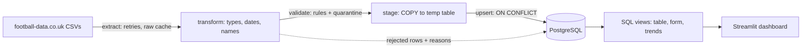

# Football Data Pipeline

An end-to-end data engineering project. It downloads football match results from
[football-data.co.uk](https://www.football-data.co.uk/), cleans and validates them with
pandas, loads them into PostgreSQL with idempotent SQL upserts, models them with SQL views,
and serves a Streamlit dashboard. Tests and CI run against a real PostgreSQL, and a
scheduled workflow keeps the data fresh.



## Quick start

```bash
docker compose up -d                       # PostgreSQL on localhost:5432
pip install -e ".[dev,dashboard]"

football-pipeline run --leagues E0 SP1 --recent 3   # download, clean, load
streamlit run dashboard/app.py                      # explore
pytest                                              # 130+ tests
```

No internet or just want a demo? Generate **synthetic** seasons (random data, real club
names for familiarity) and load them offline:

```bash
football-pipeline sample-data --seasons 2324 2425 2526
football-pipeline run --seasons 2324 2425 2526 --offline
```

Set `DATABASE_URL` to use a different database (see `.env.example`).

## What it demonstrates

| Skill | Where |
|---|---|
| Resilient extraction (retries, 404 handling, raw-file cache for replay) | `extract.py` |
| Cleaning messy real-world data (mixed date formats, padded names, blank rows) | `transform.py` |
| Explicit data-quality rules; bad rows are quarantined with a reason, never dropped | `validate.py`, `rejected_rows` table |
| Relational modelling, constraints, indexes, migrations | `src/football_pipeline/sql/` |
| Idempotent bulk loading: `COPY` to staging, then one set-based `INSERT ... ON CONFLICT` | `load.py` |
| Transaction design: data load is all-or-nothing, audit row commits independently | `pipeline.py` |
| Analytics in SQL: CTEs, window functions (`rank`, `row_number`, running sums) | `sql/004-008_*.sql` |
| Testing against a real database, with an isolated schema per test | `tests/conftest.py` |
| CI and scheduled updates | `.github/workflows/` |

## Design decisions

- **Idempotency over incrementality.** Every load is an upsert keyed on the fixture
  (league, season, date, home, away). Re-running changes nothing; corrected source data
  updates the stored row; `IS DISTINCT FROM` avoids rewriting identical rows, so
  `updated_at` only moves on real changes. Scheduled runs and retries are therefore safe.
- **Constraints live in the database too.** Result-matches-score, no self-matches, foreign
  keys and range checks are `CHECK`/`FK` constraints, so bad data cannot enter even if
  the Python layer is bypassed. `tests/test_schema_constraints.py` proves it.
- **Nothing is silently dropped.** Rows failing validation go to `rejected_rows` as JSONB
  with their reason, and every run records counts in `ingestion_runs`. The identity
  `extracted = rejected + duplicates + loaded` holds and is tested.
- **Failures are isolated and visible.** One bad league/season is rolled back, audited as
  `failed`, and does not stop the others; the CLI exits non-zero so schedulers alert.
- **Views are cross-checked.** The league table view is tested against an independent
  pandas calculation, and the running-points view must reconcile with the table.
- **Raw files are cached untouched**, so any run can be replayed or audited offline.

## Data model

`leagues` and `teams` (dimensions), `matches` (fact), `ingestion_runs` and `rejected_rows`
(audit). Views: `v_match_results`, `v_team_matches` (one row per team per match),
`v_league_table`, `v_team_form`, `v_season_summary`, `v_points_progression`.

## Automation

- **CI** (`ci.yml`): ruff, format check and pytest with coverage on Python 3.11 and 3.13
  against a `postgres:16` service. `REQUIRE_DB=1` makes DB tests fail rather than skip.
- **Scheduled update** (`update.yml`): daily cron running `football-pipeline run`. Add a
  `DATABASE_URL` repository secret pointing at a hosted PostgreSQL. A local alternative:
  `0 6 * * * cd /path/to/repo && football-pipeline run --recent 2`.

## Data and licensing

Match data comes from football-data.co.uk; check their terms before redistributing it.
Files produced by `sample-data` are synthetic and must not be mistaken for real results.

## Project layout

```
src/football_pipeline/   config, extract, transform, validate, load, audit, pipeline,
                         queries, charts, cli, sample_data, sql/ (migrations + views)
dashboard/app.py         Streamlit UI
tests/                   unit, SQL and end-to-end tests
```
